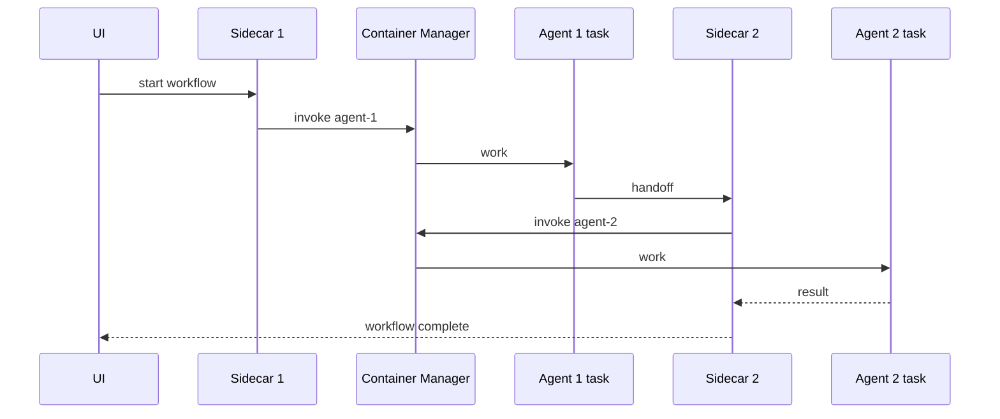

# Mastro Agent Pool Demo

This proof of concept demonstrates `UI -> Sidecar 1 -> Agent 1 -> Sidecar 2 -> Agent 2`.
Agents are short-lived ECS EC2 tasks managed by the Container Manager, never ECS Services.

## Local run

```powershell
Copy-Item .env.example .env
docker compose -f docker-compose.local.yml up --build
```

Open http://localhost:8080 and select **Start Workflow**. The local manager uses
`MOCK_ECS=true` to launch logical Agent 1 and Agent 2 tasks only when invoked.
The five always-on components are the only Compose services.

## AWS deployment

The Deployment Manager uses boto3 directly (there is no Terraform state). Before
deploying, install the dependencies, configure AWS credentials with permission
to create ECR, IAM, ECS, EC2/Auto Scaling, Cloud Map, ELBv2, and SSM resources,
and provide a VPC with at least one private and one public subnet. The caller
must provide an image URI for each of the seven components. The ECS-optimized
Amazon Linux 2023 AMI is resolved from the public SSM parameter.

Required environment variables (request fields override them):

* `AWS_REGION` (default is `ap-south-1`), `VPC_ID`
* `PRIVATE_SUBNET_IDS` and `PUBLIC_SUBNET_IDS` (comma-separated)
* `IMAGE_URI_UI`, `IMAGE_URI_DEPLOYMENT_MANAGER`,
  `IMAGE_URI_CONTAINER_MANAGER`, `IMAGE_URI_SIDECAR_1`, `IMAGE_URI_SIDECAR_2`,
  `IMAGE_URI_AGENT_1`, and `IMAGE_URI_AGENT_2`
* `MOCK_ECS=true` keeps local development entirely in-memory; set it to
  `false` for AWS provisioning.

Optional capacity settings are `ECS_INSTANCE_TYPE` (default `t3.micro`),
`ECS_MIN_INSTANCES`, `ECS_MAX_INSTANCES`, and `ECS_DESIRED_INSTANCES`.
The AWS identity must be allowed to pass the task and EC2 roles. Run:

```bash
curl -X POST http://localhost:8001/deploy \
  -H 'content-type: application/json' -d '{"environment":"demo"}'
curl http://localhost:8001/deployments/{deployment_id}
```

The Swagger request body can include:

```json
{
  "environment": "demo",
  "region": "ap-south-1",
  "vpc_id": "vpc-xxxxxxxx",
  "private_subnet_ids": ["subnet-private-a", "subnet-private-b"],
  "public_subnet_ids": ["subnet-public-a", "subnet-public-b"],
  "image_uris": {
    "ui": "123456789012.dkr.ecr.ap-south-1.amazonaws.com/mastro-agent-pool-ui:latest",
    "container-manager": "123456789012.dkr.ecr.ap-south-1.amazonaws.com/mastro-agent-pool-container-manager:latest",
    "sidecar-1": "123456789012.dkr.ecr.ap-south-1.amazonaws.com/mastro-agent-pool-sidecar-1:latest",
    "sidecar-2": "123456789012.dkr.ecr.ap-south-1.amazonaws.com/mastro-agent-pool-sidecar-2:latest",
    "agent-1": "123456789012.dkr.ecr.ap-south-1.amazonaws.com/mastro-agent-pool-agent-1:latest",
    "agent-2": "123456789012.dkr.ecr.ap-south-1.amazonaws.com/mastro-agent-pool-agent-2:latest",
    "deployment-manager": "123456789012.dkr.ecr.ap-south-1.amazonaws.com/mastro-agent-pool-deployment-manager:latest"
  }
}
```

The locally running Deployment Manager has Swagger at
http://localhost:8001/docs. Set AWS credentials and submit `region`, `vpc_id`,
subnet IDs, and image URIs there. It provisions/reuses ECR and stable named
AWS resources, registers Cloud Map service discovery, creates the ECS-optimized
EC2 capacity provider with managed scaling, termination protection, and
draining, and creates an internet-facing ALB routing only to the UI. Agent 1
and Agent 2 are task definitions (not ECS Services), suitable for the
Container Manager to start with ECS `RunTask` when a workflow needs them.

The local Compose Deployment Manager reads the host AWS CLI profile through a
read-only `${USERPROFILE}\.aws` mount. Configure credentials with
`aws configure`, optionally set `AWS_PROFILE`, and do not put access keys in
Compose or the Swagger request.

## API

* Container Manager: `/health`, `/agents`, `/agents/register`, `/agents/{id}/heartbeat`,
  `/agents/{type}/invoke`
* Sidecars: `POST /invoke`, `GET /health`
* Agents: `GET /health`, `GET /capacity`, `POST /work`
* Deployment Manager: `/health`, `/deploy`, `/deployments`, `/deployments/{id}`,
  `/deployments/{id}/destroy`

## Architecture



`MOCK_ECS` is local-only. Real AWS requires ECR images, private networking,
IAM permissions, an ALB for the UI, and an ECS-optimized EC2 capacity provider.
